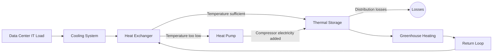
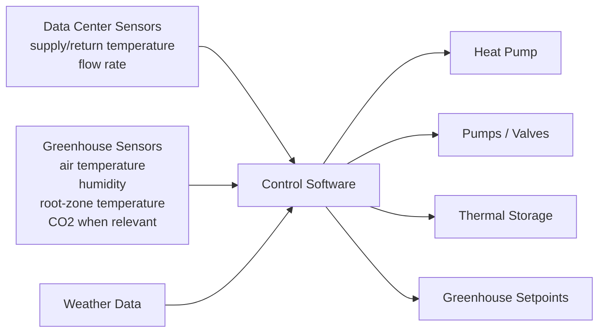
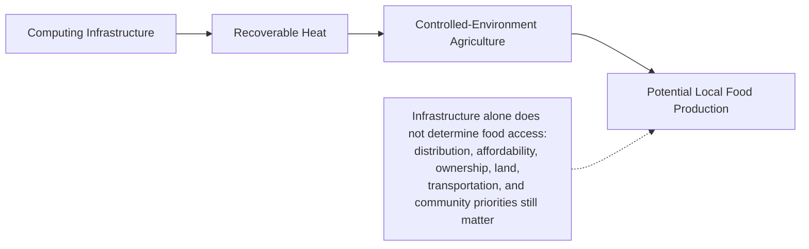
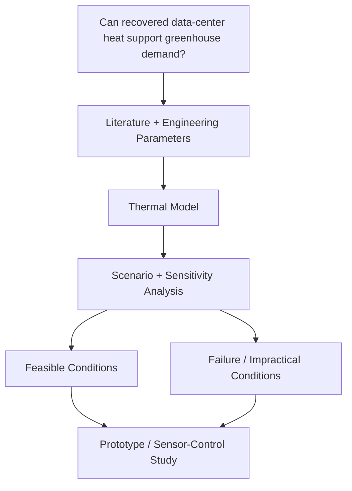

# Compute → Heat → Food

In March 2026, I started wondering why data-center heat is treated entirely as
something to remove while other systems spend energy making heat. Greenhouses
have the opposite problem. Could those two systems ever make sense together?

This repository tests one version of that idea: recover heat from data-center
cooling systems and use it for controlled-environment agriculture. I am also
interested in the siting question—whether a connection could support local food
production near communities with limited access to affordable fresh food.

The answer is not automatically yes. So I wanted to run the numbers.

The concept began in March 2026. This public repository was created and
expanded in October 2026; it was not invented for an application.

## Why I Started This

I kept coming back to two things that felt strange to look at separately:
enormous computing demand and enormous amounts of heat that data centers work
hard to remove. At the same time, greenhouses spend energy trying to keep a
useful growing temperature. I wanted to know whether those systems could ever
fit together in a way that survives an honest calculation.

The part that pulled me in was siting. If a data center is already becoming part
of a community, could some of its thermal infrastructure support something
locally useful instead of treating every joule as a disposal problem? Controlled-
environment agriculture near communities with limited fresh-food access seemed
like one possibility worth testing.

This is my attempt to stop treating that as a shower thought and actually run
the numbers.

## Two questions

1. **Engineering:** Can useful thermal energy from a data center be recovered at
   a temperature and reliability a greenhouse can use?
2. **Community and siting:** If it can, are there situations where colocating
   the systems could support useful year-round local production?

The second question is not a claim that a greenhouse beside a data center fixes
food insecurity. Food access also depends on affordability, transportation,
ownership, distribution, land use, crop choice, and community participation.
The model reports potential thermal and production capacity, not “people fed.”

## The model

The calculation follows the energy through explicit checkpoints:

\[
Q_{generated}=P_{IT}f_{load}f_{heat}
\]

\[
Q_{HX}=Q_{generated}f_{collect}\epsilon_{HX}
\]

Direct exchange is allowed only when the coolant outlet is at least the
greenhouse supply temperature plus a stated approach temperature. Otherwise,
the model uses a bounded Carnot-fraction heat-pump screen and reports its
electricity separately:

\[
Q_{cond}=Q_{HX}\frac{COP}{COP-1}, \qquad
Q_{delivered}=Q_{cond}(1-L_{distribution})
\]

Greenhouse peak sensible demand is:

\[
q''=\left(Ur_A+\frac{\rho c_p ACH h}{3600}\right)
\max(T_{set}-T_{out},0)(1+m)
\]

The supported floor area is delivered heat divided by that intensity. Solar
gain, crop schedules, perimeter/ground loss, and deliberate ventilation are
left out on purpose and listed as limitations. See
[`docs/assumptions.md`](docs/assumptions.md) for every equation and
[`data/source_data.csv`](data/source_data.csv) for values, ranges, and provenance.



## What the first run says

These are generated results from the baseline row in `data/scenarios.csv`: 80%
IT load, 75% of server heat entering the recovery loop, 75% exchanger
effectiveness, 35 °C source, 40 °C greenhouse supply, 8% distribution loss,
18 °C indoor setpoint, a 3.98 W/m²-K double-poly envelope, 0.75 ACH, and 0 °C
outdoors. They are scenario outputs, not measured facts.

| IT nameplate | Operating IT → heat | Ideal nameplate heat | Heat after collection + HX | Delivered heat | Peak-supported floor area |
|---:|---:|---:|---:|---:|---:|
| 1 MW | 0.80 MW | 1.00 MW | 0.45 MW | 0.497 MW | 3,595 m² (0.36 ha) |
| 10 MW | 8.00 MW | 10.00 MW | 4.50 MW | 4.968 MW | 35,950 m² (3.60 ha) |
| 50 MW | 40.00 MW | 50.00 MW | 22.50 MW | 24.840 MW | 179,751 m² (17.98 ha) |

The baseline uses a heat pump with COP 6.0 and 0.90 MW of compressor power at
10 MW IT. The apparent increase from 4.50 MW after the exchanger to 4.968 MW
delivered is heat-pump electricity becoming condenser heat; it is not free
recovered energy.

### Temperature, weather, and failure checks

| Scenario | Path | HP electricity | Delivered heat | Peak-supported area |
|---|---|---:|---:|---:|
| 25 °C coolant, 10 MW IT | Heat pump, COP 5.73 | 0.952 MW | 5.016 MW | 36,297 m² |
| 35 °C coolant, 10 MW IT | Heat pump, COP 6.00 | 0.900 MW | 4.968 MW | 35,950 m² |
| 45 °C coolant, 10 MW IT | Direct exchange | 0 | 4.140 MW | 29,958 m² |
| 55 °C coolant, 10 MW IT | Direct exchange | 0 | 4.140 MW | 29,958 m² |
| 35 °C source, −10 °C outdoors | Heat pump | 0.900 MW | 4.968 MW | 23,111 m² |
| 35 °C source, 10 °C outdoors | Heat pump | 0.900 MW | 4.968 MW | 80,888 m² |
| Stress case: 50% load, 40% collection, leaky envelope | Heat pump | 0.300 MW | 1.275 MW | 2,876 m² |
| Favorable case: 95% load, 90% collection, improved envelope | Direct exchange | 0 | 6.977 MW | 72,311 m² |

The 45 °C row is the direct-use threshold in this simplified model, not a
universal temperature at which every greenhouse emitter works. In practice,
direct use is usually preferable to adding a heat pump, even if a heat pump can
raise delivered thermal power, because the compressor needs electricity and the
system still needs backup cooling.

### Short-term mismatch and storage

`data/illustrative_day.csv` is a clearly labeled synthetic winter day. It pairs
an outdoor-temperature curve with a changing compute load; it is not a Charlotte
weather record. For a 26,963 m² greenhouse in that profile:

| Quantity | Result |
|---|---:|
| Ideal lossless cyclic storage | 8,777 kWh |
| Screening design store (20% headroom) | 10,532 kWh |
| Equivalent water volume at a 20 °C swing | 454 m³ |
| Backup heat with that store in the illustrative day | 0 kWh |

The same run curtails about 19,373 kWh of surplus and loses about 195 kWh to
the modeled tank’s standing loss. A one-day, initially full tank is not seasonal
storage; it is a way to make the timing problem visible.

Generated tables and plots live in [`results/`](results/) and [`figures/`](figures/).

## Information and control

The thermal calculation is only useful if a real system can observe its own
temperatures, flow, weather, and crop conditions.



## How to reproduce it

From the repository root:

```bash
python -m venv .venv
source .venv/bin/activate
python -m pip install -r requirements.txt
python scripts/generate_results.py
python scripts/build_notebooks.py
jupyter nbconvert --to notebook --execute --inplace \
  --ExecutePreprocessor.timeout=120 notebooks/01_baseline.ipynb \
  notebooks/02_sensitivity_analysis.ipynb \
  notebooks/03_siting_scenarios.ipynb
pytest
```

The core functions are intentionally small and auditable:

- [`src/heat_recovery.py`](src/heat_recovery.py) — IT heat, collection,
  exchanger, direct-use check, and distribution.
- [`src/heat_pump.py`](src/heat_pump.py) — bounded Carnot-fraction COP and
  explicit compressor power.
- [`src/greenhouse_load.py`](src/greenhouse_load.py) — transmission,
  infiltration, and supported-area equations.
- [`src/thermal_storage.py`](src/thermal_storage.py) — mismatch dispatch,
  cyclic storage sizing, and water-volume conversion.
- [`src/simulation.py`](src/simulation.py) — scenario assembly.

## The wider idea



This is a possible infrastructure benefit worth studying, not a claim that
technical capacity automatically creates food access. A serious siting study
would ask residents, growers, food organizations, land owners, and local
governments what would be useful and affordable. It would also check whether
the data center can guarantee heat, whether a backup cooler remains available,
and whether piping, permitting, ownership, and distribution make sense.

## Research workflow



The project is meant to show the failure conditions too: low source temperature,
poor collection, long distribution paths, cold weather, leaky envelopes,
unreliable heat availability, and a community context where production is not
affordable or wanted.

## Where This Could Go Next

While researching this concept, I became interested in systems where computing
infrastructure can interact with biological systems instead of existing
separately from them. That is part of why UNC Charlotte’s BRANE research
immediately interested me. This repository is still an independent project; it
does not represent collaboration with Dr. Kim or the lab, and it was not built
to imply one.

The timeline matters: March 2026 was the original concept, October 2026 is the
public repository and expanded computational analysis, and Spring 2027 is when I
encountered BRANE while preparing an OUR application.

## Sources and limitations

The source list is in [`references/sources.md`](references/sources.md). The
engineering assumptions and units are in [`docs/assumptions.md`](docs/assumptions.md),
the idea and timeline are in [`docs/concept.md`](docs/concept.md), and the
failure modes are in [`docs/limitations.md`](docs/limitations.md).
